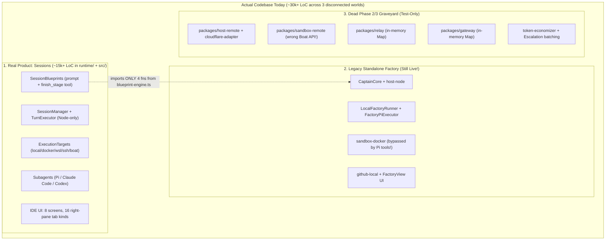

# ADE Codebase vs. `docs/DESIGN.md` — Candid Drift Audit

> **Scope:** Full code-level audit of `packages/`, `runtime/`, `src/`, `scripts/`, `src-tauri/`, and `public/` against [DESIGN.md](./DESIGN.md) (and contextualized with [DESIGN_REVIEW.md](./DESIGN_REVIEW.md) and [IMPLEMENTATION_PLAN.md](./IMPLEMENTATION_PLAN.md)).

---

## 1. The Brutally Honest Executive Summary

Your codebase has **not** merely drifted from [DESIGN.md](./DESIGN.md) — **it quietly pivoted to a different product, then stitched a cosmetic bridge back to the original spec without deleting the old half or finishing the new one.**

Here is what actually happened in git history and why the repo feels heavy right now:

1. **Act 1 (`DESIGN.md` v2):** You designed a disciplined, modular **Software Factory** — *"GitHub Issue In, Merge-Ready PR Out"*, Single Captain UX (zero tab fatigue), 4 clean seams (`BlueprintEngine`, `CaptainHost`, `SandboxProvider`, `ModelRouter`), `packages/captain-core` as ~90% of the runtime on `pi-durable`/`pi-ai`, lazy Docker/Boat sandboxes, independent zero-memory **Goldfish** audits, honest telemetry, Two Flavors (All Local vs. All Remote on Cloudflare DO), EU Sovereignty, and a Mobile-First PWA.
2. **Act 2 (`DESIGN_REVIEW.md`, Nov 22 → `R1`–`R15` + `run-targets` + `subagent-harnesses` + `ade-server` + `overnight`):** You benchmarked ADE against Conductor, Claude Code, Antigravity, and Paseo, and sprinted hard on **local multi-agent IDE sessions**: worktrees, run/check scripts, checkpoints, PR review/CI-fix loops, Best-of-N attempts, automations, Slack/Linear, transcripts, MCP, host-side CDP browser, 5 execution targets (`local`/`docker`/`wsl`/`ssh`/`boat`), multi-harness subagents (Pi/Claude Code/Codex), custom fonts/keybindings/palettes, artefacts viewer, and SSH-tunneled `ade-server.ts`.
   - **Be proud of this part:** This is where the real engineering velocity went, and it is genuinely strong. Durable Pi Captain + multi-harness subagents + real `runtime/boat.ts` + worktree PR review loops + overnight limits/guardrails are real competitive advantages.
3. **Act 3 (`f23f8d6` & `0d066b1`, §3.5 "Blueprints run inside sessions"):** You rightly realized two separate products ("Sessions" vs. "Software Factory") was untenable and appended §3.5 to unify them. **However**, the implementation only wired a thin prompt-and-tracker overlay (`finish_stage`) + drawer UI onto Sessions, while leaving:
   - The **old standalone Factory** still booted, routed, polled, and visible across the app.
   - **4 of 10 `packages/`** as 100% dead test-only prototypes (and 3 more used only by the legacy Factory).
   - **Almost every differentiator in `DESIGN.md`** (per-stage model switching, EU fail-closed policy, tool pruning, `pi-codemode`, lazy sandboxes, enforced Goldfish cross-family audit, Failure-Loop Watchdog, Scribe memory, structured subagent escalation batching, Docker-by-default isolation, Mobile PWA) either **unimplemented in Sessions**, **prompt-only theater**, or **silently broken**.

> [!IMPORTANT]
> **Why this matters if you want the best ADE out there:** Great dev tools win on **coherence, trust, and execution depth**, not checkbox surface area. Right now ADE looks like a 10-person team's sprawling control plane on the surface, while core promises in [DESIGN.md](./DESIGN.md) (EU-Only guard, Docker isolation, Goldfish cross-family audit, encrypted relay, stage model routing, mobile PWA) either silently do nothing or have active security/correctness bugs.

---

## 2. Section-by-Section Scorecard (`DESIGN.md` vs. Code)

| `DESIGN.md` Section | Verdict | Reality in Code |
| :--- | :--- | :--- |
| **§1 Single Product ("One product, not a separate Factory")** | **Split-Brain** | Legacy Factory (`FactoryView`, `/api/factory/*`, `LocalFactoryRunner`) is still unconditionally booted, polled, and wired into Sidebar, Project topbar, Project tabs, and Issue rows. |
| **§1 & §3.2 Single Captain UX (Zero Tab Fatigue)** | **Severe Drift** | Evolved into a heavyweight IDE: 8 screens, 2 stacked left bars, 6 project tabs, 16 right-pane tab kinds, direct subagent steering, 3-up pinned subagent views, no escalation batching, no Pause/Take Over in Sessions. |
| **§2 Exactly Two Flavors (Local vs. Hosted CF DO)** | **Diverged** | Actual topology is a 2-axis self-hosted matrix (`localhost` or SSH-tunneled `ade-server.ts` × 5 run targets). Zero Cloudflare Worker/DO deployment; Tauri does not bundle the daemon. |
| **§3.1 Issue → Merge-Ready PR + Goldfish Audit** | **Half-Wired** | Session PR panel creates manual freeform PRs (no spec/verification/Goldfish summary). Issue URL lookup is public-only. Goldfish in Sessions is prompt-only with no cross-family enforcement or `pi-codemode`. |
| **§3.3 Pluggable Blueprints + Per-Stage Models + Telemetry** | **Prompt-Only / Broken** | 5 built-ins exist (`bmad` missing, `.ade/blueprint.json` never loaded). Sessions hardcode a dummy `MODEL_CONFIG` and ignore `modelProfile`/`stageOverrides`. `token-economizer.ts` is 100% dead and **still fabricates USD savings**. |
| **§3.4 Multi-Device & Mobile-First PWA** | **Broken / Stubbed** | `manifest.webmanifest` lacks icons (not installable), 0% Service Worker/Web Push, no `src/mobile/` or 4 mobile screens, no voice dictation, only 5 `@media` queries in 4,130 lines of `ade.css`, relay endpoint wiped on reload. |
| **§3.5 Blueprints Inside Sessions** | **~55% Done** | Core drawer (`Stages \| Terminal`), `StageBar`, `ProgressPanel`, Inbox/Slack gate alerts, and `vibe` DB migration work. Missing: automations blueprint, hard gate stops, failure auto-open, stage-card buttons/subagent lists, and real stage execution semantics. |
| **§4 Seam 1–4 (`captain-core`, `CaptainHost`, `SandboxProvider`, `ModelRouter`)** | **Bypassed** | `captain-core` never imports `pi-durable`, `pi-ai`, or `pi-codemode`. `runtime/` is ~15k+ prod LoC instead of a ~200L thin host. `ExecutionTargets` bypassed `SandboxProvider` completely. |
| **§5 EU Residency vs. True EU Sovereignty** | **Vaporware** | Live Sessions completely ignore `euOnlyMode` and `cloudActFree`. None of the EU/Sovereign providers (`mistral`, `bedrock-eu`, `vertex-eu`, `azure-openai-eu`, `eu-vllm`) exist in `runtime/models.ts`. Zero GitLab/Gitea/Forgejo support. |
| **§6 Security & Credential Boundaries** | **Critical Gaps** | Captain & subagents run unsandboxed on host OS by default; Factory Docker container is bypassed by Pi tools; **MCP `env`/`headers` secrets leak verbatim to the UI**; host `process.env` LLM keys leak into local shells; raw LLM keys forwarded into remote VMs. |

---

## 3. Deep-Dive Drift Analysis (Code-Verified)

### Drift 1: Split-Brain Architecture & A 4-Package Graveyard

You currently maintain **three overlapping architectures** in one repo:

1. **Sessions (the real product):** Uses [packages/protocol](../packages/protocol/index.ts), [packages/blueprints](../packages/blueprints/index.ts), and **only** the 4 pure transition helpers from [blueprint-engine.ts](../packages/captain-core/blueprint-engine.ts). Everything else (Pi Durable sessions, models, Docker/Boat/SSH/WSL, GitHub, PRs) lives in `runtime/`.
2. **Legacy Standalone Factory (still live & booted on every startup):**
   - [host.ts](../runtime/host.ts#L117-L135) unconditionally instantiates `createNodeSqliteCaptainHost`, `CaptainCore`, `LocalFactoryRunner`, `createPiFactoryStageExecutor`, `LocalDockerSandbox`, and `LocalGitHubProvider`.
   - [server.ts](../runtime/server.ts#L119) registers all `/api/factory/*` routes ([factory.ts](../runtime/routes/factory.ts#L8-L111)), where `GET /api/factory/capabilities` advertises `lazyHandsOnDemand: true`, `goldfishQualityAudit: true`, `tokenEconomizer: true`, `euOnlyModeGuard: true` even though Sessions implement none of them.
   - Frontend still mounts `<FactoryView />` ([AppMainColumn.tsx](../src/layout/AppMainColumn.tsx#L233-L247)), polls `/api/factory/runs` ([useProjects.ts](../src/hooks/useProjects.ts#L54-L99)), lists factory runs in [Sidebar.tsx](../src/sidebar/Sidebar.tsx#L317-L334), renders competing `Factory run` + `New session` buttons in [ProjectStreamsWorkspace.tsx](../src/projects/ProjectStreamsWorkspace.tsx#L167-L174), and shows **both** `Start session` and `Factory run` on every GitHub issue row ([FactoryIssuesList.tsx](../src/factory/FactoryIssuesList.tsx#L161-L199)).
3. **4 Dead Phase 2/3 Packages (100% test-only):**
   - `git grep` shows [packages/host-remote](../packages/host-remote/index.ts), [packages/sandbox-remote](../packages/sandbox-remote/index.ts), [packages/relay](../packages/relay/index.ts), and [packages/gateway](../packages/gateway/index.ts) have **zero imports** anywhere in `runtime/`, `src/`, or `scripts/` — they are only imported by [platform.test.ts](../packages/host-remote/platform.test.ts#L14-L18).
   - Worse, they are actively misleading or broken:
     - [sandbox-remote/index.ts](../packages/sandbox-remote/index.ts#L84-L162) (`BoatSandbox`) targets a **fictional API** (`https://api.boat.dev/v1`, `/exec`, `/workers`, `/pause`, no `X-Ascii-Confirm-Delete`), directly contradicting your real Boat.dev client in [boat.ts](../runtime/boat.ts#L8-L59) (`https://boat.dev/api/v1`, `/sshkey`, `X-Ascii-Confirm-Delete`).
     - [host-remote/index.ts](../packages/host-remote/index.ts) has **no `/step`, `/approve`, `/steer`, or executor** — `POST /api/factory/runs` and GitHub webhooks leave every run permanently stuck in `status: "idle"`.
     - [relay/index.ts](../packages/relay/index.ts) (102 lines) and [gateway/index.ts](../packages/gateway/index.ts) (151 lines) are pure in-memory `Map` classes with zero WebSocket, HTTP, LLM proxy, persistence, or E2EE transport.

**Concrete User-Facing Bugs Caused Directly by the Split-Brain:**
- **Every Vibe project lies in the header:** [ProjectStreamsWorkspace.tsx](../src/projects/ProjectStreamsWorkspace.tsx#L111) resolves the header badge against `BUILTIN_BLUEPRINTS` (which excludes `"vibe"`), so every Vibe project falsely displays `Automated Factory (Lite)`.
- **Two incompatible Project Settings UIs:** [ProjectsView.tsx](../ProjectsView.tsx#L315-L463) has `vibe` + `blueprintLocked` + `modelProfile` (no EU toggles, no per-stage overrides), while [ProjectConfigModal.tsx](../src/factory/ProjectConfigModal.tsx#L28-L388) defaults to `automated-factory`, omits `vibe` and `blueprintLocked`, and is the only place showing EU toggles and per-stage overrides.
- **`Cmd+N` modal drifted behind `NewSessionView`:** [CreateWorktreeModal.tsx](../src/workspace/CreateWorktreeModal.tsx#L455-L464) has **no blueprint picker at all** and still lets users pick `claude-code` / `codex` as the primary session engine (contradicting `DESIGN_REVIEW.md` and [NewSessionView.tsx](../src/workspace/NewSessionView.tsx#L277)).

---

### Drift 2: Blueprints Inside Sessions (§3.5) Are Mostly Prompt Theater

[DESIGN.md](./DESIGN.md#L154-L158) promises that blueprint stages control **which tools, model, checks, parallel subagents, and zero-history Goldfish reviewer apply**. In the actual code ([session-blueprints.ts](../runtime/session-blueprints.ts)), a blueprint session is essentially **a markdown prompt injected into the system prompt + one `finish_stage` tool that updates a JSON blob in SQLite**.

Look at what is **actually enforced vs. merely suggested in prompt text**:

| Blueprint Primitive | Enforced by Runtime? | Exact Code Reality |
| :--- | :---: | :--- |
| **Per-stage model switching (`ModelRouter`)** | **No** | [session-blueprints.ts](../runtime/session-blueprints.ts#L54-L55) hardcodes `MODEL_CONFIG = { profile: "balanced", appDefault: { provider: "session", model: "session" }, compliance: { euOnlyMode: false } }`. [turn-executor.ts](../runtime/services/turn-executor.ts#L128-L154) always uses one session model; `finish_stage` never reconfigures the model mid-turn. |
| **Stage-scoped & learned tool pruning** | **No** | [session-manager.ts](../runtime/services/session-manager.ts#L174-L213) installs **every** tool unconditionally (write, search, shell, subagents, browser, artifacts, skills, MCP). `stage.allowedToolGroups` is never read. [token-economizer.ts](../packages/captain-core/token-economizer.ts) is **100% dead in production**. |
| **Hard stop at approval gates** | **No (honor system)** | `createExtension(sessionId, onWaiting)` ([session-blueprints.ts](../runtime/session-blueprints.ts#L313)) accepts an `onWaiting` hook, **but [session-manager.ts](../runtime/services/session-manager.ts#L206) never passes it**. When a gate is reached, `finish_stage` merely returns text telling the LLM `"Stop here: end your turn"`. Nothing prevents a chatty or autopilot agent from continuing to edit files in the same turn. |
| **Lazy sandbox attachment (`requiresSandbox`)** | **No** | Worktrees and run targets (Docker/Boat/SSH) are created and started eagerly at session creation ([task-store.ts](../runtime/db/task-store.ts#L308), [sessions.ts](../runtime/routes/sessions.ts#L268-L273)) and restarted on boot ([agent-workflow.ts](../runtime/agent-workflow.ts#L80-L84)). |
| **Automatic `deterministicChecks`** | **No (prompt hint)** | [session-blueprints.ts](../runtime/session-blueprints.ts#L372) prints ``Checks: `build`, `lint`, `test`...`` as text. Nothing runs them or blocks `finish_stage`. (Even legacy [factory-runner.ts](../runtime/factory-runner.ts#L461-L465) ignores `deterministicChecks` and just runs `git status --short`!) |
| **Independent Goldfish quality audit + `pi-codemode`** | **Prompt-only / Incomplete** | [session-blueprints.ts](../runtime/session-blueprints.ts#L369-L371) asks the Captain to call `spawn_subagent` in `readonly` mode without leaking reasoning. Nothing enforces it, **cross-family model routing is never applied** ([subagents.ts](../runtime/subagents.ts#L222) uses Captain's model or one flat `piModel`), and **`@earendil-works/pi-codemode` is vendored in `package.json` but imported 0 times anywhere in the repo**. |
| **`parallel_subagents` execution** | **Prompt-only** | Advisory text in [session-blueprints.ts](../runtime/session-blueprints.ts#L363); `maxParallelSubagents` and `workerHarness` are not mechanically enforced. Legacy Factory doesn't implement parallel workers at all. |
| **Scribe memory (`decisions.md` + `micro-skills.md`)** | **No** | No post-PR Scribe step exists. `microSkillsPath` is never read anywhere in `runtime/`; `decisionsLogPath` is only a read-only prompt hint ([session-blueprints.ts](../runtime/session-blueprints.ts#L202)). |
| **Failure-Loop Watchdog (3× identical errors)** | **No** | Instantiated in [captain-runtime.ts](../packages/captain-core/captain-runtime.ts#L39), but `recordFailure()` / `recordSuccess()` are **never called in production**. |
| **Honest Telemetry (zero counterfactuals)** | **Violated in code** | [token-economizer.ts](../packages/captain-core/token-economizer.ts#L141-L162) still defines `estimateTokenSavings()` fabricating `loopInterventions * 12_000` tokens and `estimatedUsdSaved` — the exact practice banned by [DESIGN.md](./DESIGN.md#L102). Meanwhile Sessions have **no** per-stage/per-PR token breakdown, pruned-schema counter, or loop-intervention counter. |
| **Custom `.ade/blueprint.json` & `bmad`** | **No** | Nothing ever reads `.ade/blueprint.json` from disk (`resolveProjectBlueprint` in [packages/blueprints/index.ts](../packages/blueprints/index.ts#L79) has 0 prod callers). `bmad` does not exist. |

**Specific §3.5 Bugs & Gaps Already in the New Session Blueprint Code:**
- **Automations ignore blueprints:** Neither [automations.ts](../runtime/automations.ts#L17-L30) nor [ProjectAutomationsTab.tsx](../src/projects/ProjectAutomationsTab.tsx#L10-L141) has a `blueprintId` field (explicitly required by §3.5 lines 162 & 166).
- **Locked-project switch contradiction:** [resolveSessionBlueprint](../runtime/session-blueprints.ts#L350-L356) blocks switching mid-session from a blueprint to Vibe when `blueprintLocked` is true — directly contradicting §3.5 line 158 (*"going from a blueprint to Vibe is always allowed"*).
- **State-machine bugs in [blueprint-engine.ts](../packages/captain-core/blueprint-engine.ts):**
  - Lines 166–171: `completeStage` sets `stageState.status = "changes_requested"` and immediately overwrites it to `"pending"` in the loop on line 169.
  - Lines 226–231: `request_changes` on a `"before"` gate sets status to `"pending"`, so the next `planNextStep()` loops right back into `awaiting_approval` with no work done.
- **Drawer & Stages UI gaps vs. §3.5:**
  - [SplitWorkspace.tsx](../src/workspace/SplitWorkspace.tsx#L161) initializes `drawerTab` once and **doesn't reset it when switching from a Vibe session to a blueprint session** (so it stays stuck on `Terminal`).
  - [SplitWorkspace.tsx](../src/workspace/SplitWorkspace.tsx#L190-L199) auto-opens the drawer on `awaiting_approval`, but **not** on `status === "failed"` (§3.5 line 149).
  - [StagesPanel.tsx](../src/blueprints/StagesPanel.tsx#L83-L128) puts Approve/Request changes in a separate footer banner (only visible when that stage is selected) instead of on the waiting stage card, and omits per-stage subagent rows (`Build · 3 of 5`), produced-artifact subtitles under cards, deterministic check results, and attribution.
- **External CLI escape hatch:** Switching a session via `POST /api/sessions/:id/engine` ([agent-workflow.ts](../runtime/agent-workflow.ts#L114-L118)) bypasses `SessionBlueprints`, `ApprovalManager`, MCP, and Browser entirely.

---

### Drift 3: The Four Modular Seams (§4) Were Bypassed — `runtime/` Became a 15k+ LoC Local Monolith

[DESIGN.md](./DESIGN.md#L210-L221) set a clear architectural north star:
- `packages/captain-core` (~90% of Captain code, pure Web-standard APIs, built on `pi-durable` and `pi-ai`).
- `runtime/` shrunk into a ~200-line thin `LocalNodeHost` wrapper.

**What actually happened:**
- `packages/captain-core` stayed pure (zero `node:*` imports — good!), **but it contains zero `@earendil-works/pi-durable`, `@earendil-works/pi-ai`, or `@earendil-works/pi-codemode` code.** It is just a pure TypeScript state-machine library that Sessions barely touch.
- Meanwhile `runtime/` grew to **~22,045 total lines (~15k+ production LoC)** across ~70 files, tightly coupled to Node (`node:fs`, `node:child_process`, `node:sqlite`, `node-pty`). Even though `host.ts` (378L) and `server.ts` (379L) were refactored into `db/`, `services/`, and `routes/`, the complexity shifted into [agent-workflow.ts](../runtime/agent-workflow.ts) (392L), [execution-targets.ts](../runtime/execution-targets.ts) (659L), [browser.ts](../runtime/browser.ts) (716L), and a 29-field `RouteDeps` bag ([context.ts](../runtime/routes/context.ts)).
- **State fragmentation:** Persistence is scattered across `ade-host.sqlite`, per-session `coding-task-*.sqlite`, `factory-sessions/*.sqlite`, Git refs (`refs/ade/checkpoints/*`), and **~10 separate ad-hoc JSON files** (`automations.json`, `limits.json`, `execution-targets.json`, `integrations.json`, `project-scripts.json`, `project-secrets.json`, `subagent-policy.json`, `usage.json`, `engines.json`, `environments.json`).
- **Process-global mutable singletons:** `setSecretResolver`, `setExecutionTargets`, `setExternalSubagentRunner`, and `startFromService` undermine clean dependency injection and make porting to a multi-tenant or remote host much harder.
- **Seam bugs left unfixed:**
  - [model-router.ts](../packages/captain-core/model-router.ts#L197-L226): `profile.roles[stage.defaultModelRole]` always matches for every valid role **before** `config.projectOverride` and `config.appDefault` are ever checked — making `projectOverride` and `appDefault` unreachable dead code.
  - [host-node/index.ts](../packages/host-node/index.ts#L36-L52): Escapes `%`/`_` with `\` in `LIKE` queries without `ESCAPE '\'`, breaking prefix listings containing underscores.
  - [captain-runtime.ts](../packages/captain-core/captain-runtime.ts#L38-L40): `#activeSandboxes` and `this.escalations` are in-memory `Map`s, not persisted to `host.storage` (lost on restart/hibernation).

---

### Drift 4: "Single Captain UX (Zero Tab Fatigue)" Became a Heavyweight IDE

Compare [DESIGN.md](./DESIGN.md#L25) (*"Single Captain UX — Zero Tab Fatigue, With Escape Hatch ... read-only glass box ... Pause / Take Over"*) against what is actually rendered in the UI today:

- **UI Surface Area Explosion:**
  - **8 top-level screens** (`inbox`, `projects`, `project`, `work`, `factory`, `settings`, `worktrees`, `attempts`).
  - **2 stacked left bars**: a 48px VSCode-style Activity Bar (4 global icons + up to **12 dynamically injected session tool icons** + Settings) next to a resizable 200–360px Workspace Sidebar with 3 header popovers, project tree, sessions, factory runs, chats, archived accordion, and host footer.
  - **Project screen**: 6 top tabs (`Sessions`, `Factory`, `Issues`, `Pull requests`, `Agents`, `Automations`) + `List | Side by side` toggle + 3 multi-pane layouts (`single | split | grid`) + 3-tab right inspector (`Files | Artefacts | Settings`).
  - **Session screen**: Header bar with up to 8 badges + `AmbientTracksBar` (7 toolbar pills + 2 sub-drawers) + `ComposerDock` (3 popovers + 3-column `ModelPicker` hardcoding 16 providers including `antigravity`, `muse-code`, `hermes`, `devin` + 4 panel buttons) + right `BesidePane` with **unlimited closable tabs across 16 `WorkspaceTabKind`s** (which even **auto-opens** the `Agents` tab side-by-side when a subagent starts at [SplitWorkspace.tsx](../src/workspace/SplitWorkspace.tsx#L255-L266)!) + bottom resizable drawer.
  - **11 Settings categories** (with [ProvidersPanel.tsx](../src/settings/ProvidersPanel.tsx#L34-L52) storing CLI binary/home/env overrides only in browser `localStorage`, disconnected from the host!).
- **Not a Read-Only Glass Box, and No Escalation Batching:**
  - [SubagentPanel.tsx](../src/panels/SubagentPanel.tsx#L98-L116) exposes an **always-open direct chat input** (`Steer` / `Send follow-up`) to subagents, and [AgentsView.tsx](../src/agents/AgentsView.tsx#L77-L78) encourages pinning **3 subagents side-by-side** with direct steering and manual branch merging. That is the exact multi-tab/multi-agent cognitive load §1 promised to eliminate.
  - **No Pause / Take Over** exists in Sessions (only `Abort` or `Steer`).
  - **No structured subagent protocol** (`progress`, `question`, `spec_conflict`, `artifact`, `completed`, `failed`): [subagents.ts](../runtime/subagents.ts#L262-L293) returns plain text strings only.
  - **No batched escalation cards (`Approve Spec`, `Choose Option A/B`, `Approve PR`):** [TimelineView.tsx](../src/timeline/TimelineView.tsx#L196-L262) only renders generic shell/MCP command-approval cards. `EscalationAggregator.enqueueSubagentSignal()` / `flushSubagentBatch()` ([escalation.ts](../packages/captain-core/escalation.ts#L17-L77)) are dead code.
  - **Subagent stop bug:** The Captain's `stop_subagent` tool ([subagents.ts](../runtime/subagents.ts#L412-L426)) only aborts the Pi child conversation and **forgets to call `externalSubagents()?.stop(...)`** for Claude Code / Codex workers (unlike the HTTP route at [sessions.ts](../runtime/routes/sessions.ts#L408-L420)).

---

### Drift 5: Sandboxing & Security Boundaries (§4 Seam 3, §6) Are Inverted

> [!CAUTION]
> Several security claims in [DESIGN.md](./DESIGN.md#L223-L289) are not just unimplemented — **the current codebase violates them in ways that create real credential exposure and false safety assumptions.**

1. **Captain & Subagents Run Unsandboxed on the Host OS by Default:**
   - `DESIGN.md`: *"The Captain never runs shell commands directly... worker isolation via Docker containers (replacing current host-OS filesystem access)."*
   - Reality: [session-manager.ts](../runtime/services/session-manager.ts#L176-L181) attaches `createShellTools` directly to the Captain. [execution-targets.ts](../runtime/execution-targets.ts#L179) defaults every project/session to `target: "local"`. All Captain and subagent shell commands spawn `/bin/zsh -lc ...` directly on the host OS.
   - Even the macOS `sandbox-exec` profile written in [shell-tools.ts](../runtime/shell-tools.ts#L35-L45) is **dead code** — zero callers pass `sandbox: true`.
   - Under `auto-all` (Autopilot), Codex runs on the host with `--dangerously-bypass-approvals-and-sandbox` ([engines.ts](../runtime/engines.ts#L150)) and Claude Code with `--permission-mode bypassPermissions` (mitigated only by `--settings` deny rules).
2. **Critical Docker Bypass Bug in Legacy Factory:**
   - In [factory-pi-executor.ts](../runtime/factory-pi-executor.ts#L251-L259), even after `LocalDockerSandbox` boots a container running `sleep infinity`, `createPiFactoryStageExecutor` registers `createShellTools({ sessionId: "factory:..." })`. Because `factory:...` is never registered in `ExecutionTargets`, **every agent shell command silently bypasses the Docker container and runs on the host OS!**
   - Meanwhile [LocalDockerSandbox.spawnWorker](../packages/sandbox-docker/index.ts#L208-L215) is a no-op stub, and when Docker is absent in `"auto"` mode, it falls back to host execution while still reporting `handle.provider = "docker"`.
3. **Weak Isolation Even When Opting Into `target: "docker"`:**
   - [execution-targets.ts](../runtime/execution-targets.ts#L343-L371) bind-mounts host `~/.claude`, `~/.codex`, `~/.claude.json`, the repo's `.git` common dir, and the entire `worktreesRoot` **read-write** into the container, running as `root` on macOS/Windows.
4. **Active Secret Exposure & Storage Drift:**
   - **MCP secrets leak verbatim to the frontend:** [mcp.ts](../runtime/mcp.ts#L244-L246) stores `env` and `headers` (e.g. `Authorization: Bearer ...`) in plaintext SQLite `mcp_servers.configJson` and returns them unredacted in `GET /api/mcp` ([mcp.ts](../runtime/routes/mcp.ts#L7)) and SSE `mcp.update` broadcasts.
   - **Host `process.env` leaks into every local shell command:** [shell-tools.ts](../runtime/shell-tools.ts#L129) passes `{ ...process.env, ...secrets }` to every spawned command, exposing host `OPENAI_API_KEY`, `ANTHROPIC_API_KEY`, `GH_TOKEN`, AWS keys, etc., and `redact()` only masks `project-secrets`, not `process.env`.
   - **Plaintext non-Keychain secrets:** Boat.dev API key, Slack webhook, Linear API key ([integrations.ts](../runtime/integrations.ts#L52-L72)) and project secrets ([project-secrets.ts](../runtime/project-secrets.ts#L33-L39)) live in plaintext `0o600` JSON files rather than OS Keychain/DPAPI. And on headless Linux (`ade-server.ts`), OS Keychain (`libsecret`) fails without a D-Bus session ([copilot-auth.ts](../runtime/copilot-auth.ts#L267)).
   - **Raw LLM API keys enter remote VMs:** [engines.ts](../runtime/engines.ts#L298-L300) forwards `ANTHROPIC_API_KEY`, `CLAUDE_CODE_OAUTH_TOKEN`, `OPENAI_API_KEY`, and `CODEX_API_KEY` straight into Docker/SSH/Boat VMs — there is no scoped LLM proxy gateway or signed callback endpoint outside unit tests.

---

### Drift 6: "Exactly Two Flavors" & Mobile-First PWA (§2, §3.4)

- **Topology Drift:** Instead of Flavor 1 (All Local) vs. Flavor 2 (Hosted Cloudflare DO), you actually built a **self-hosted 2-axis topology**:
  - Runtime host: local loopback OR SSH-provisioned Linux daemon ([ade-server.ts](../scripts/ade-server.ts)) connected via SSH port-forwarding ([environments.ts](../runtime/environments.ts#L212-L262)).
  - Session execution target: `local | docker | wsl | ssh | boat` ([execution-targets.ts](../runtime/execution-targets.ts)).
  - **Honest take:** For power developers and EU self-hosters, `ade-server.ts` + Docker/Boat is actually *cleaner and more practical* than Cloudflare DOs — **but it does not match `DESIGN.md`**, and the Cloudflare DO adapter ([cloudflare-adapter.ts](../packages/host-remote/cloudflare-adapter.ts)) has no `wrangler.json`, no Worker class, no `PiHarness`, and an alarm-overwrite bug (`lines 59–66`).
- **Tauri Desktop Shell Is Bare:** [src-tauri/src/main.rs](../src-tauri/src/main.rs#L1-L7) is 7 lines and does **not** bundle or launch the Node daemon; [tauri.conf.json](../src-tauri/tauri.conf.json#L14-L16) sets `"bundle": { "active": false }` and restricts CSP `connect-src` to `localhost:1420` (blocking remote Flavor 2 URLs).
- **Mobile PWA Is Essentially Non-Existent:**
  - [manifest.webmanifest](../public/manifest.webmanifest#L1-L9) has **no `icons`** (and `public/` contains zero icon assets) — browsers reject it as an installable PWA.
  - **0%** Service Worker, **0%** Web Push, **0%** voice dictation, **no `src/mobile/`** and none of the 4 mobile screens.
  - [src/ade.css](../src/ade.css) (4,130 lines) has only **5 `@media` queries** total (while [style.css](../style.css) carries ~22 `@media` queries targeting dead legacy class names!). Mobile Stages view is trapped inside a 240px bottom drawer instead of full-screen (§3.5 line 150).
- **Remote / Relay Switching UI Is Broken in 4 Ways:**
  1. [api.ts](../api.ts#L3-L18) stores `activeEndpoint` in an in-memory `let` — **refreshing the page wipes your connection back to `local`**.
  2. [EnvironmentSettings.tsx](../EnvironmentSettings.tsx#L157-L224) displays `"Paired via encrypted relay"` (no E2EE or relay daemon exists) and never refreshes projects/sessions or reconnects SSE when switching endpoints.
  3. [EventStreamContext.tsx](../src/hooks/EventStreamContext.tsx#L81) uses native `EventSource`, which **cannot send `Authorization: Bearer`** headers to authenticated remote/relay Captains.
  4. [EnvironmentPalette.tsx](../src/sidebar/EnvironmentPalette.tsx) is blind to `getCaptainEndpoint()`, and there is no offline/sleeping-Mac screen (§3.4 line 114).

---

### Drift 7: EU Data Residency & True EU Sovereignty (§5) Is Vaporware

This is the sharpest credibility gap if you market ADE in Europe:
- Projects persist `modelProfile`, `euOnlyMode`, `cloudActFree`, and `stageOverrides` in SQLite ([migrations.ts](../runtime/db/migrations.ts#L83-L85)), and [ProjectsView.tsx](../ProjectsView.tsx#L449-L450) lets users pick `EU-Only (GDPR)` or `EU Sovereign (CLOUD-Act-Free)` — **yet live Sessions completely ignore all of those fields** and happily send code to US OpenAI/Anthropic/Copilot endpoints.
- [runtime/models.ts](../runtime/models.ts#L180-L186) only implements 5 providers (`openai`, `anthropic`, `compatible`, `github-copilot`, `radius`). **Zero** of the EU/Sovereign providers defined in [model-router.ts](../packages/captain-core/model-router.ts#L19-L32) (`bedrock-eu`, `vertex-eu`, `azure-openai-eu`, `mistral`, `eu-vllm`, `scaleway-ai`, `ollama`) exist in `runtime/models.ts`. Enabling `euOnlyMode` or `cloudActFree` in legacy Factory simply crashes with `"provider ... is not configured in Settings"`.
- **Zero GitLab EU / Gitea / Forgejo integration** (only placeholder text for HTTPS `git clone`).

---

### Drift 8: GitHub Issue → Merge-Ready PR (§3.1, §7) Is Half-Wired

- **Private issue split-brain:** [github-issues.ts](../runtime/github-issues.ts#L54-L63) (`POST /api/github/issues/lookup`) still makes an **unauthenticated `fetch()`** and fails on private repos — even though [github-repositories.ts](../runtime/github-repositories.ts#L167-L232) already uses `gh auth token` and reads private repos cleanly!
- **No spec-linked PR summaries in Sessions:** [session-git.ts](../runtime/session-git.ts#L460-L474) + [PullRequestPanel.tsx](../src/panels/PullRequestPanel.tsx#L97-L99) only create a manual freeform PR (`Closes #N`). No acceptance-criteria mapping, verification check outputs, screenshots, or Goldfish audit verdict are attached. (Legacy Factory's `buildMergeReadyPrBody` hardcodes `checksSummary: "- Verified in isolated local sandbox."` at [factory-runner.ts](../runtime/factory-runner.ts#L417).)
- **No GitHub App adapter:** Zero App ID / JWT / installation-token code exists for Flavor 2; [host-remote/index.ts](../packages/host-remote/index.ts#L132-L139) skips webhook HMAC verification entirely if no secret is passed.

---

## 4. What You Should Keep vs. What You Should Cut or Fix

Be ruthless here. To make ADE **the best ADE out there**, stop trying to satisfy every sentence of an aspirational cloud-enterprise spec while simultaneously cloning every IDE feature from Conductor/Cursor. **Lean into what already makes your Sessions engine genuinely special**, and make the core promises rock-solid.

### What's Genuinely Great in Today's Codebase (Keep & Double Down)
1. **Durable Pi Captain + Multi-Harness Subagents (Pi / Claude Code / Codex):** Almost nobody else combines crash-resilient durable orchestration with the ability to delegate work across the user's existing Claude Code / Codex subscriptions *and* API-key Pi workers.
2. **Worktree-First Sessions + Real Review Loop:** Readable branches, checkpoints/rewind, PR comment & CI-failure feedback loop, branch conflict updates, setup/run/check scripts, and Best-of-N attempts are killer daily-driver workflows.
3. **Real `ExecutionTargets` (`local`/`docker`/`wsl`/`ssh`/`boat`) + `ade-server.ts`:** Pragmatic, zero-vendor-lock-in remote compute that actually matches Boat.dev's real API and lets users run ADE 24/7 on a €10/mo Hetzner box today.
4. **Hard Command Guardrails + Overnight Limits & Usage-Limit Waiting:** Exactly what unattended/overnight agentic coding actually needs.

### Prioritized Realignment Plan

#### Phase A — Kill the Split-Brain & Fix Trust/Security Bugs (Do First — 1 week)
1. **Delete the legacy Factory completely:** Remove `runtime/factory-runner.ts`, `runtime/factory-pi-executor.ts`, `runtime/routes/factory.ts`, `src/factory/*`, `LiveFactoryRunPane`, `packages/sandbox-docker`, `packages/github-local`, and `packages/host-node` (or archive what you actually port into Sessions). Fix `ProjectStreamsWorkspace` header pill for `vibe`, remove the duplicate `ProjectConfigModal`, and kill/align `CreateWorktreeModal` (`Cmd+N`).
2. **Quarantine or delete the 4 dead prototype packages:** `packages/host-remote`, `packages/sandbox-remote`, `packages/relay`, `packages/gateway` are creating false architectural confidence (and `BoatSandbox` is factually wrong). Delete them or move them to an explicit `experimental/` folder until you actually build Flavor 2.
3. **Fix immediate security & correctness bugs:**
   - Stop returning MCP `env` and `headers` secrets in `GET /api/mcp` and SSE `mcp.update` ([mcp.ts](../runtime/mcp.ts#L244-L246)).
   - Strip LLM API keys / sensitive tokens from `process.env` before spawning local shell commands ([shell-tools.ts](../runtime/shell-tools.ts#L129)), and wire macOS `sandbox-exec` (`sandbox: true`) as an optional local floor.
   - Fix `runtime/github-issues.ts` to use `gh auth token` so private issue lookup works.
   - Fix `stop_subagent` tool in [subagents.ts](../runtime/subagents.ts#L412-L426) to also stop Claude Code / Codex subagents.
   - Fix `api.ts` endpoint persistence + SSE Bearer auth (or hide the fake "Encrypted relay" pairing UI until a real relay exists).
   - Delete `estimateTokenSavings()` from [token-economizer.ts](../packages/captain-core/token-economizer.ts#L141-L162) so you never ship counterfactual savings.

#### Phase B — Make Blueprints Real, Not Prompt Theater (The Moat — 1–2 weeks)
This is what turns ADE from "another Conductor clone" into **the best ADE out there**:
1. **Real stage enforcement in `SessionBlueprints`:**
   - Pass `onWaiting` from `SessionManager` so hitting an approval gate **mechanically terminates/pauses the turn** instead of asking the LLM to stop.
   - Wire `stage.allowedToolGroups` into `SessionManager` so Brain-only/review stages genuinely prune write/shell/browser tools (and count real pruned schemas).
   - Wire `ModelRouter` (after fixing its precedence bug!) into `TurnExecutor` + `finish_stage` so stages genuinely switch models mid-session and **fail closed** when `euOnlyMode` is enabled.
   - Add real `mistral` and OpenAI-compatible EU/Ollama provider presets to `runtime/models.ts` so `EU-Only` / `EU-Sovereign` / `Local/Ollama` profiles actually work instead of crashing.
2. **Real Independent Goldfish Audit:**
   - When entering a `contextIsolation: "goldfish"` stage, **the runtime itself** (not a prompt suggestion) spawns a zero-history read-only subagent on a **different model family** (when configured), passes only the spec + diff + repo access, and feeds its structured verdict into `completeStage`.
3. **Real Deterministic Checks & Failure-Loop Watchdog:**
   - Execute `stage.deterministicChecks` (or the project's `check` script) mechanically before allowing a `verify` stage to finish.
   - Wire `FailureLoopWatchdog` into `TurnExecutor` / tool execution (3× identical edit/test failure → intervene/escalate).
4. **Close the §3.5 gaps:** Add `blueprintId` to Automations, load `.ade/blueprint.json`, fix `blueprint-engine.ts` state transitions, fix `SplitWorkspace` tab reset & auto-open on `failed`, put Approve/Request changes directly on the waiting stage card, and generate spec + verification + Goldfish PR bodies automatically in `PullRequestPanel`.

#### Phase C — Ruthlessly Simplify the UX Back Toward "Single Captain" (1 week)
- Collapse redundant navigation: you don't need 8 screens + 2 stacked left bars + 6 project tabs + 16 right-pane tab kinds + a side-by-side 3-subagent wall.
- Decide clearly: is a subagent a **glass-box worker managed by the Captain** (`DESIGN.md`) or a **parallel chat you steer yourself** (`AgentsView`)? Pick one primary mental model (keep direct takeover behind an explicit **Pause / Take Over** escape hatch).
- Render blueprint gates and structured Captain questions as **first-class Decision Cards inline in the Captain timeline and Inbox** (`Approve Spec`, `Request Changes`, `Choose Option A/B`, `Approve PR`).
- Make `Settings → Providers` persist to the host (not `localStorage`) and expose 1-click **Model Profiles** + optional stage overrides in one clean place.

#### Phase D — Rewrite `DESIGN.md` Honestly for Flavor 2 & Mobile
- **Make an explicit call on Flavor 2:** Your real momentum is `ade-server.ts` (self-hosted EU Linux box / Docker / Boat.dev) — NOT Cloudflare Durable Objects. Running `packages/host-node` + SQLite on Hetzner/Scaleway/OVH is actually *better* for EU Sovereignty (zero US CLOUD Act!) and avoids rewriting 15k lines of Node runtime into WebWorkers. Update `DESIGN.md` to reflect that truth instead of pretending Cloudflare DO is around the corner.
- **Make Mobile PWA real (or cut the claim for v1):** Add icons, Service Worker, responsive shell breakpoints in `ade.css`, authenticated real-time transport (WebSocket or cookie/token-safe SSE), and a real outbound relay (or Tailscale/`ade-server` HTTPS endpoint) — otherwise stop claiming mobile handover until it works.
